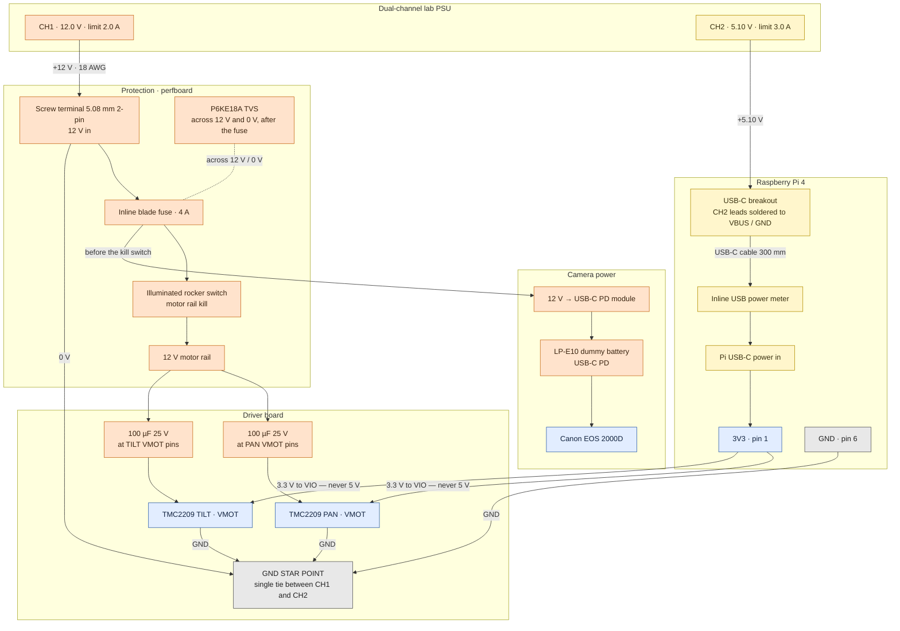
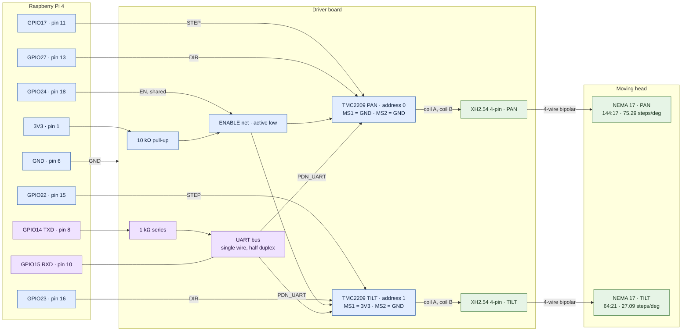

# UGR Evaluation Rig — Electrical Connections

Rev 2 · 2026-09-23 · dual-channel lab supply, TMC2209 in step/dir + UART mode

Electrical scope only: power rails, protection, driver board, driver UART and motor wiring.
This is the wiring reference; `PIVOT_DETAIL.md` points here. Data paths (camera USB, network)
are out of scope — see `REQUIREMENTS.md` §7.

The rig is **always** powered from a dual-channel lab supply. There is no vehicle power path.

Rendered diagrams: `connections-power.svg`, `connections-signals.svg` (generated from the
Mermaid blocks below — edit the Mermaid, then re-render).

---

## 1. Rail summary

| Rail | Source | Voltage | Current limit | Protection | Feeds |
|---|---|---|---|---|---|
| Motor + camera | PSU CH1 | 12.0 V | 2.0 A | 4 A blade fuse · P6KE18A TVS · rocker kill (motors only) | VMOT on both TMC2209 · 12 V→USB-PD module for the camera |
| Pi | PSU CH2 | **5.10 V** | 3.0 A | Pi's own input polyfuse | Raspberry Pi 4 via USB-C |
| Driver logic | Pi 3V3 pin | 3.3 V | — | — | VIO on both TMC2209, pull-up, MS1 strap on TILT |

Set CH2 to **5.10 V, not 5.00 V**. The Pi 4 flags undervoltage below ~4.63 V; leads and the
USB-C connector can eat 200–300 mV. Check the voltage on the inline USB meter under load.

The camera PD module is tapped **after the fuse but before the rocker**, so killing the motors
does not cut the camera mid-write. Camera draw is ~0.3 A at 12 V; motors well under 1 A at the
currents used, so the 2.0 A limit has margin.

---

## 2. Power diagram

---

## 3. Signal diagram

---

## 4. Connection tables

### 4.1 Pi header to driver board

Nine wires. Nothing else crosses between the Pi and the board.

| Pi pin | BCM | Board net | Note |
|---|---|---|---|
| 11 | GPIO17 | PAN STEP | |
| 13 | GPIO27 | PAN DIR | |
| 15 | GPIO22 | TILT STEP | |
| 16 | GPIO23 | TILT DIR | |
| 18 | GPIO24 | ENABLE, shared, active low | 10 kΩ pull-up to 3V3 on the board |
| 8 | GPIO14 TXD | UART bus via 1 kΩ | |
| 10 | GPIO15 RXD | UART bus, direct | |
| 1 | 3V3 | VIO both drivers, pull-up, TILT MS1 | |
| 6 | GND | star point | |

GPIO18/19 stay free — pigpio's timing peripheral.

### 4.2 Driver straps

| Driver | MS1 | MS2 | UART address | Microstepping |
|---|---|---|---|---|
| PAN | GND | GND | 0 | 1/16, set over UART |
| TILT | 3V3 | GND | 1 | 1/16, set over UART |

MS1/MS2 are address pins in this design, not microstep selectors. **If the UART configuration
has not been written, the straps alone give PAN 1/8 and TILT 1/32** — every angle would be
wrong. The software must not enable the drivers until it has written and read back the
configuration (§6).

SPREAD: leave at its default (GND, StealthChop). INDEX, DIAG, CLK: not connected.

### 4.3 UART bus

One wire joins both PDN_UART pins. Pi TX drives it through 1 kΩ; Pi RX sits directly on it.
The resistor lets a driver answer on the same wire without fighting the Pi's TX output. Confirm
the PDN_UART pin position on the SilentStepStick silkscreen before wiring.

### 4.4 Driver board to head

Eight wires leave the board, all motor phases. No signal wiring travels with the motion.

| Connector | Wires | To |
|---|---|---|
| XH2.54 4-pin, PAN | coil A pair, coil B pair | NEMA 17, pan |
| XH2.54 4-pin, TILT | coil A pair, coil B pair | NEMA 17, tilt |

**Confirm coil pairs with a multimeter before crimping** — continuity means same coil. Swapping
a whole pair only reverses direction, which is the `invert` flag in `config/mount.toml`.

### 4.5 PSU to board and Pi

| From | To | Wire |
|---|---|---|
| CH1 +12 V / 0 V | screw terminal | 18 AWG silicone |
| Fuse output | 12 V→USB-PD module input (before rocker) | 18 AWG silicone |
| CH2 +5.10 V / 0 V | USB-C breakout VBUS / GND → 300 mm C-C cable → USB meter → Pi | short leads |

Signal wiring is 22 AWG. Cable-tie every bundle where it leaves the board.

---

## 5. Grounding

One tie between CH1 0 V and the Pi's ground, at the star point on the perfboard. Lab PSU
channels are isolated from each other, so this tie is **required** — the STEP/DIR/UART inputs are
referenced to the Pi's ground. Do not also link the channels at the PSU.

The camera adds a second, unavoidable path: dummy battery ground (from CH1) → camera → USB
tether → Pi. It carries no motor current as long as the motor return goes straight to the star
point. Keep the PD module leads short.

---

## 6. Driver configuration over UART

Motor current and microstepping are set in software, not with the trimpot. Written at startup
by `hal/tmc2209.py` (to be written — own thin layer, TMC2209 datasheet as spec):

| Register | Setting |
|---|---|
| GCONF | `pdn_disable=1` (pin is UART), `mstep_reg_select=1` (microsteps from register), `i_scale_analog=0` (ignore Vref) |
| CHOPCONF | `MRES` = 1/16 |
| IHOLD_IRUN | run and hold current, from `config/mount.toml`, per axis |
| DRV_STATUS | read: over-temperature pre-warning / shutdown, open load, short |
| GSTAT / IFCNT | read: reset flag and write counter, to verify writes landed |

Rules:

- ENABLE stays high (drivers off) until both drivers have been written **and read back**. On a
  mismatch or no answer, refuse to enable.
- **The TMC2209 needs VMOT to talk.** With the motor rail off, UART is silent. Configure only
  after the rocker is on.
- **Cycling the motor rail resets the drivers** to strap defaults (1/8 and 1/32). Check GSTAT
  before every move; if a reset is flagged, reconfigure and mark the position uncertain.
- Hold current is applied at standstill, i.e. during the bracket. Lowering it risks tilt creep
  under a heavy lens — measure before relying on it (`PIVOT_DETAIL.md` §8.6).

Pi setup, once: in `/boot/firmware/config.txt` set `enable_uart=1` and `dtoverlay=disable-bt`
(puts the full PL011 UART on GPIO14/15; Bluetooth is not used), disable the serial login console
in `raspi-config`, and use `/dev/serial0` at 115 200 baud.

---

## 7. Bring-up sequence

Every time:

1. Rocker **off**. Drivers seated the right way round, caps fitted, straps checked.
2. CH2 on. Pi boots. Confirm ~5.1 V on the USB meter under load.
3. Confirm 3.3 V at both VIO pins. Confirm ENABLE reads high with the Pi idle.
4. CH1 on. Camera powers up through the PD module.
5. Rocker **on**. Confirm 12 V at both VMOT pins.
6. Software configures both drivers over UART and reads back. Only then enable and move.

Power down: shut the Pi down from the web UI, rocker off, CH1 off, CH2 off.

---

## 8. Ways this gets destroyed

- **VIO at 5 V.** Input threshold ends up above what the Pi outputs. Drops steps under load and
  looks like backlash.
- **Missing or distant VMOT caps.** 100 µF at the driver's own pins.
- **Hot-plugging a motor.** Rocker off before touching a motor connector.
- **Powering the Pi through header pins 2/4.** Bypasses input protection. Use USB-C.
- **Pi TX straight onto the bus without the 1 kΩ.** A driver answering fights the Pi's output.
- **Enabling before UART config is verified.** Wrong microstepping, silently wrong angles.
- **Two ground ties between the channels.** See §5.
- **Reversed 12 V.** The TVS sits after the fuse, so reversed polarity makes it conduct and the
  CH1 current limit holds it there. Don't rely on it — check the terminal before switching on.
