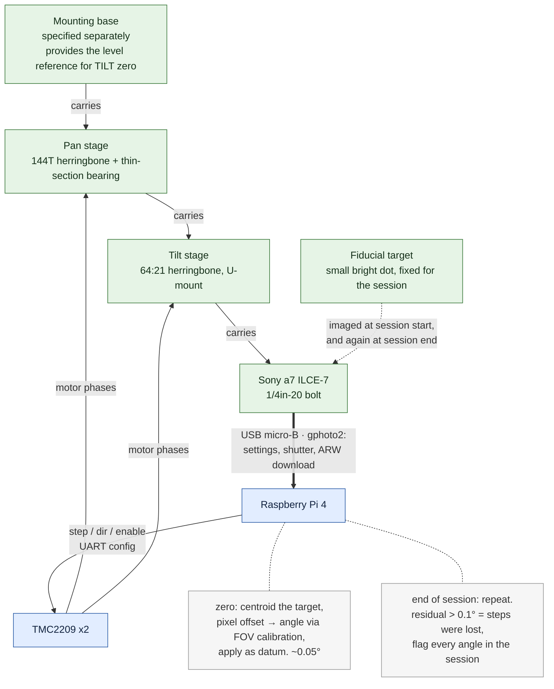

# Pan-Tilt Head — detail

Rev 3 · 2026-09-23. High-level summary in `PIVOT_OVERVIEW.md`. Wiring in `CONNECTIONS.md`.
Mechanics from isaac879's Pan-Tilt-Mount (MIT), slider axis removed. Control is ours.

---

## 1. Bill of materials

Costs and part numbers: `SHOPPING_LIST.md` and `SOURCING.md` (purchasing docs, kept outside this repo).

### 1.1 Electronics

| Item | Qty | Note |
|---|---|---|
| Raspberry Pi 4 | 1 | pigpio does not support Pi 5 — see §4.1 |
| NEMA 17, **QSH4218-35-10-027**, 35 mm body, 1.8° | 2 | The upstream CAD is dimensioned for a 23 mm body, which approved distributors don't stock. Check the printed motor mounts for clearance, edit the mount if it fouls |
| TMC2209 SilentStepStick | 2 | Step/dir for motion, UART for configuration (§4.4) |
| 100 µF electrolytic, ≥25 V | 2 | Across VMOT and GND, at the driver pins |
| Perfboard | 1 | No PCB fabrication — §2 |
| 10 kΩ resistor | 1 | ENABLE pull-up |
| 1 kΩ resistor | 1 | UART TX series resistor |
| 2.54 mm 8-pin female headers | 4 | Socket the drivers, don't solder them |
| XH2.54 4-pin socket + plug | 2 | Motor leads, crimped |
| Screw terminal 5.08 mm, 2-pin | 1 | 12 V in from lab PSU CH1 |
| Inline blade fuse holder + 4 A fuse | 1 | 12 V rail |
| P6KE18A TVS | 1 | Across the 12 V rail after the fuse |
| Illuminated rocker switch, 12 V | 1 | Motor rail kill |
| Fiducial target | 1 | Small bright dot — the optical zero reference, §5 |

### 1.2 Mechanics

Printed: 17T herringbone gear · 144T herringbone gear base mount · Pan Mount · Pan Mount Bearing
Clamp · Base Mount Bearing Clip Ring · Tilt U-Mount · Gear Side Support · Idle Side Support ·
Gear Side Bearing Mount · Idle Side Bearing Mount · 21T + 64T herringbone gears · 3 mm→5 mm
wheel bearing spacers ×4. PETG, not PLA — gears creep above PLA's Tg.

Hardware: INA CSXU050-2RS 127×146.05×12.7 mm thin-section bearing (or the printable bearing parts
1–3 + 28 × 6 mm BB pellets) · F623ZZ 3×10×4 flanged bearings ×6 · M3 nyloc nuts ×16 · M3 square
nuts ×10 · M3 button-head bolts, 40/20/16/12/8/6/3.5 mm · M3×5×4 heat-set inserts · 1/4"-20
camera bolt.

No belts or pulleys — both axes are herringbone gears. The 64T tilt gear has a 6.5 mm magnet
pocket and the CAD includes a hall sensor mount; both are unused.

---

## 2. Wiring

Full wiring, diagrams, pin tables, straps and bring-up: **`CONNECTIONS.md`**.

In short: nine wires from the Pi header to the driver board — two STEP, two DIR, one shared
ENABLE (10 kΩ pull-up, active low), UART TX (through 1 kΩ) and RX on one shared bus to both
drivers' PDN_UART, 3V3 and GND. Eight wires leave the board for the head, all motor phases.
Power is a dual-channel lab supply: CH1 12 V for motors and camera, CH2 5.1 V for the Pi.

| BCM | Pi pin | Function |
|---|---|---|
| 17 / 27 | 11 / 13 | PAN STEP / DIR |
| 22 / 23 | 15 / 16 | TILT STEP / DIR |
| 24 | 18 | ENABLE, shared, active low |
| 14 / 15 | 8 / 10 | UART TX / RX to both drivers |

GPIO 18/19 stay free — pigpio's timing peripheral.

No PCB fabrication. A PCB earns its cost when a second identical rig gets built.

---

## 3. Mechanical stack and the zero loop



The camera is the position sensor, so the loop only closes through the fiducial.

---

## 4. Step generation and driver control

### 4.1 pigpio, and the Pi 4 lock-in

Steps come from pigpio **waveforms**: a list of (pin, level, delay-µs) pulses handed to the DMA
engine and clocked out at 1 µs resolution with no involvement from the Linux scheduler. A CPU
spike, a card write or the web UI does not jitter the step train. Bit-banging from Python,
`RPi.GPIO`, or `time.sleep()` loops are not acceptable here.

pigpio does not support the Pi 5. This locks the project to the Pi 4.

### 4.2 Constraints that bite

- `pigpiod` is a root daemon; the Python side is a socket client. Run it as a systemd unit with
  `-t 1` (PCM clock, leaves PWM alone) and `Requires=` from the app service.
- One wave caps at roughly 12 000 pulses — read it with `wave_get_max_pulses()`. A step is two
  pulse entries, so one wave holds ~6 000 steps, about 80° of pan.
- Both axes go in the same wave — each pulse carries an on-mask and an off-mask, so the two STEP
  pins run on independent schedules inside one transmission.
- On any exit path — exception, SIGTERM, crash — call `wave_tx_stop()` and drive ENABLE high. The
  DMA engine keeps transmitting a queued wave after the Python process dies.

### 4.3 Motion profile and long moves (as built)

Each axis gets a trapezoidal profile: linear ramp in step frequency, cruise, symmetric ramp
down. The quicker axis is stretched in time so both start and finish together. Stretching only
lowers speed and acceleration. Working speed ~5 °/s with 1 s ramps — the rig is settle-time-bound,
not throughput-bound.

The merged two-axis pulse stream is cut into waves under the pulse cap and sent back to back with
`WAVE_MODE_ONE_SHOT_SYNC`, so there is no seam between waves. At most three waves exist at once,
so memory is constant in move length. `wave_chain()` loop blocks are **not** used: they repeat a
fixed pattern and don't fit two axes at unequal step rates. Full travel of both axes is
~28 400 steps, five waves, 69 s.

### 4.4 Driver configuration over UART

The TMC2209s are configured over a shared single-wire UART; STEP/DIR/ENABLE still come from
pigpio. UART carries settings only, never motion.

- Addresses by strap: PAN 0 (MS1, MS2 low), TILT 1 (MS1 high, MS2 low).
- At startup: write GCONF (`pdn_disable`, `mstep_reg_select`, `i_scale_analog=0`), CHOPCONF
  (1/16), IHOLD_IRUN (per-axis run/hold current from config), then **read back**. Only then
  release ENABLE. On mismatch or no answer, refuse to enable.
- Without UART config the straps give PAN 1/8 and TILT 1/32 — silently wrong angles. That is
  why the read-back is mandatory.
- The driver needs VMOT to communicate, and resets to strap defaults whenever VMOT drops (rocker
  off). Check GSTAT before each move; on a reset flag, reconfigure and mark position uncertain.
- DRV_STATUS is polled for over-temperature pre-warning, open load and short.
- StallGuard is not used: unreliable at ~5 °/s. The optical drift check stays the integrity check.

Implementation: own thin layer, `hal/tmc2209.py` on pyserial, TMC2209 datasheet as the spec.
Not written yet. No GPL dependency.

---

## 5. Zeroing and the drift check

### 5.1 Datums

| Axis | Zero is | Set by |
|---|---|---|
| Tilt | optical axis horizontal | the levelling reference of whatever the head is mounted on |
| Pan | cab centreline, or a per-vehicle reference direction in the profile | the mounting setup's eye-point placement |

Mounting and positioning are specified elsewhere. What this head needs from them: a levelling
reference, and a repeatable eye-point placement.

### 5.2 Procedure

1. Level the base.
2. Place the fiducial at the reference direction — brightest small thing in frame, untouched for
   the rest of the session.
3. `pipeline/` captures a frame, centroids the target, converts the pixel offset from frame
   centre into an angle using the lens FOV calibration, and calls `mount.adjust_zero()`.

At ~50° across ~6000 px that is ~0.008°/px, so centroiding to a few pixels puts the zero inside
**0.05°**. The centroid code is the same blob detection `analysis/detection.py` needs anyway.

Fallback with no target placed: aim by eye in live view and `set_zero()` manually. Costs perhaps
±0.3° and forfeits the drift check.

### 5.3 Drift check

End of session, return to (0, 0) and re-measure the same untouched fiducial. Residual below
0.1° means the session is good; above it, the axes lost steps — log the number, flag every angle
in that session as suspect, and put it in the report.

---

## 6. Software — `hal/` (as built)

```
hal/config.py    TOML -> dataclasses; every physical constant in config/mount.toml
hal/motion.py    trapezoidal profile -> merged two-axis timeline -> pigpio pulses
hal/backend.py   PulseBackend: PigpioBackend (Pi) | SimBackend (desk)
hal/mount.py     PanTiltMount
hal/tmc2209.py   UART register layer — to be written (§4.4)
tools/mountctl.py  bench CLI + the §8 measurement procedures
```

```python
class PanTiltMount:
    @classmethod
    def from_config(cls, ...) -> "PanTiltMount"
    def enable(self) -> None
    def disable(self) -> None                       # also drops the datum
    def set_zero(self, pan_deg=0.0, tilt_deg=0.0)   # declare current pose
    def adjust_zero(self, pan_deg=0.0, tilt_deg=0.0) # shift datum, e.g. optical zero
    def move_to(self, pan_deg, tilt_deg, settle=True) -> MoveResult  # absolute, blocks
    def move_by(self, pan_deg=0.0, tilt_deg=0.0) -> MoveResult
    def jog_steps(self, pan_steps=0, tilt_steps=0)  # bench only, bypasses limits
    def abort(self) -> None                         # thread-safe
    def wait_idle(self, timeout=None) -> bool
    def position(self) -> tuple[float, float]
    def status(self) -> dict
    # properties: enabled, is_zeroed, position_certain
    # raises: NotZeroed, SoftLimit, MoveAborted (all MountError)
```

Optical zeroing lives in `pipeline/`, not here — it needs both the mount and the camera.

| Requirement | Implementation |
|---|---|
| Absolute angles | Position is signed steps from zero; degrees are a derived view |
| Backlash | Two-stage move: if an axis would arrive from the wrong side, overshoot by `backlash_deg`, then return along `approach_sign` |
| Settle | After the last wave, dwell `settle_ms`. Measured, not guessed |
| Soft limits | Min/max per axis in config, checked before any wave is built. No limit switches |
| Startup state | Position unknown until a zero is set; `move_to()` raises `NotZeroed` |
| Abort | Exact steps for completed waves, interrupted wave estimated; `position_certain` goes False |
| Driver config | UART write + read-back before enable; GSTAT reset check before each move (§4.4) |
| Hold | Drivers stay energised between directions. Hold current set over UART; how low it can go is measured (§8.6) |
| Config | `config/mount.toml` |
| Fail-safe | ENABLE released and `wave_tx_stop()` in `__exit__` and a signal handler |

---

## 7. Tilt gear ratio

`panTiltMount.h` upstream carries two constants — `7.6875` (123:16, belt) active, and
`3.047619` (64:21, herringbone) commented out. The parts list and CAD contain only the 21T and 64T
herringbone gears, so **64:21 is the ratio for a build from these STLs**; the active constant is
legacy from the standalone belt-driven mount (thing:4316563). The README's quoted 0.0369° agrees.

Inference from the BOM, not a measurement. Verify with the angle gauge — the wrong constant
scales every tilt angle by 2.52×.

---

## 8. To be measured on the built head

Numbered for reference; do them in the order listed. `tools/mountctl.py` covers 8.5, 8.1, 8.3, 8.4.

- **8.5 Soft limits** — drive each axis to mechanical interference by hand, back off, record. Before
   the first automated move. (`mountctl limits`)
- **8.1 Tilt gear ratio** against the digital angle gauge. (`mountctl ratio`)
- **8.3 Backlash margin** — approach one target from both directions. (`mountctl backlash`)
- **8.4 Angular repeatability** — zero → move → return → re-measure, 10×, log the spread.
   (`mountctl repeat`)
- **8.2 Settle time** — step the head, watch a bright point across a burst of short exposures until
   the centroid stops moving. Needs the camera; not in `mountctl`.
- **8.6 Run and hold current** with the real lens fitted, set over UART: enough torque not to stall,
   low enough to keep the driver cool during holds. Check the tilt axis does not creep during a
   full bracket at the chosen hold current.
- **8.7 Payload** — tested to just over 1 kg, a7 body is 474 g, so ~500 g of lens.
- **8.8 Motor mount clearance** for the 35 mm motor body, before assembly.
